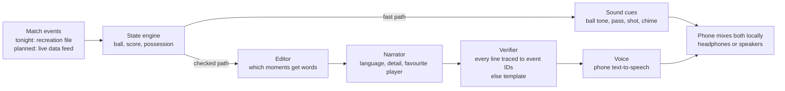

# Slides: Blind Side

Eight slides. Big type, high contrast, no club crests, no match photos. Slide 3 is mostly the phone.

---

## 1. Title

**Blind Side: football you can hear**

- Rebuilding football radio commentary for fans who can't see the pitch
- Talent Nation AI Rebuild Challenge · 21 October 2026

*Speaker notes:* Up while you're introduced. Don't read it. Go straight into the problem line.

---

## 2. Problem

**The stadium knows at once. A blind fan waits to be told.**

- About 43 million people worldwide are blind
- Radio talks to everyone the same way, and often too late
- Many others can't watch: eyes busy cooking, working, travelling

*Speaker notes:* One human sentence, then move on. The number is for the slide, not for a lecture.

---

## 3. Demo

**Close your eyes.**

- Ronaldo's overhead kick, Juventus v Real Madrid, 3 April 2018
- A recreation from public match reports. No broadcast audio or footage used.

*Speaker notes:* Speakers mode is already on. Tap Start, stay silent for 36 seconds. Then Show me what I heard, Replay, then Personalise (Pidgin, Analyst, Ronaldo) and tap a caption for the evidence.

---

## 4. How it works

**Sound carries position. Speech carries meaning.**

- Fast path: 3D sound cues go straight to the phone
- Checked path: every spoken line is verified against match events
- The phone mixes both, so the voice never hides the ball

| | Tonight | Planned (Azure version) |
|---|---|---|
| Events | Recreation file from public reports | Live data feed |
| Editor and Narrator | AI-drafted in our session, saved to a file (no API key tonight) | Called live per listener |
| Verifier | Deterministic script, real | Same script, run on every line |
| Hosting | GitHub Pages, plus one offline HTML file | Azure pipeline |

*Speaker notes:* Point at the two arrows out of the state engine. Say plainly that tonight's lines were prepared in advance and the Azure part is planned, not built.

---

## 5. AI in the loop

**AI writes the words. A checker decides what gets said.**

- Editor picks the moments, Narrator writes per listener, Verifier checks
- Any line it can't trace to events is dropped for a safe template
- Built overnight with Claude Code working as a team of agents

*Speaker notes:* Tap-a-caption is the proof: "Why we can say this" shows the event IDs. Mention the agent roles only if asked: product manager, frontend, audio, AI, reviewer.

---

## 6. Who it's for and impact

**For blind and low-vision fans first. Useful to anyone whose eyes are busy.**

- What fans told us: home use first, synced to live commentary, 3D sound
- Stadium mode is their second priority
- Free for fans; paid by broadcasters, leagues and clubs (our plan, untested)

*Speaker notes:* Say "what fans told us", never "test results". No blind user has tried this version yet.

---

## 7. Roadmap

**Next: test it with the people it's for.**

- Test with blind fans and associations in Nigeria
- Live data feeds instead of a recreation
- Azure pipeline for the Microsoft hackathon, 27 October

*Speaker notes:* Testing comes first on purpose. Everything else changes after we hear from blind fans.

---

## 8. Team and ask

**Help us put it in blind fans' ears.**

- Introductions to blind associations and football data partners
- Prize money to fund our first user tests
- Presenter: Korede [Korede: adjust team names and ask]

*Speaker notes:* Ten seconds. Say the ask, say thank you, stop talking.
